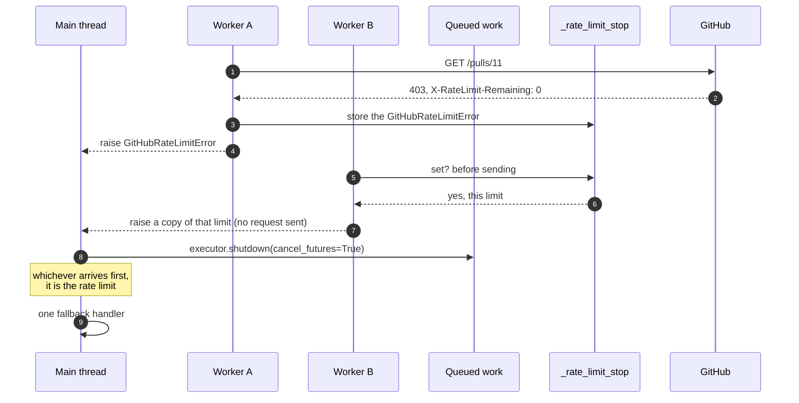
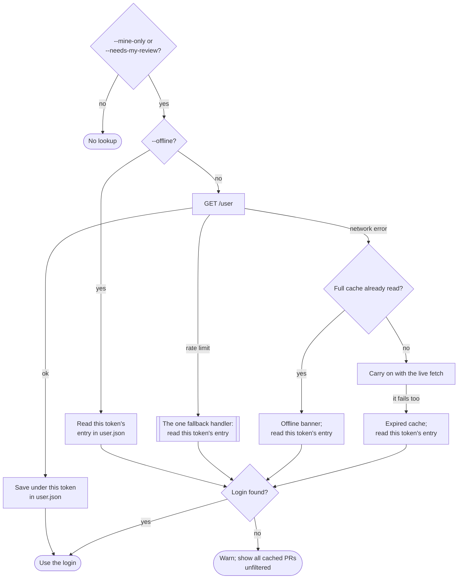

# Rate-Limit Cache Fallback

> **Tracking issue:** [#392 — Fall back to cache when GitHub API limits are exhausted](https://github.com/mrsixw/breakfast/issues/392)
>
> Builds on [PR Caching](pr-caching.md). Read that first for the cache layers.

## Overview

A big organisation can spend a GitHub rate limit before breakfast finishes
reading its pull requests. Before this change the run exited with an error, so
the user saw nothing at all at exactly the moment breakfast had a perfectly
good answer on disk from the last run.

Now a rate limit is treated like a dropped network connection: breakfast stops
asking GitHub, shows the most recent full cache however old it is, and says so.

```text
🥞 GitHub REST API rate limit exceeded; displaying local cached data from
12 minutes ago. Live GitHub data should be available after 2026-07-13 11:19:37 UTC.
```

Three pieces make that work:

1. **One fallback.** Wherever the limit strikes, a single handler serves the
   cache. ([Run flow](#run-flow))
2. **One stop signal.** The first request to hit the limit stops every other
   worker from sending another. ([Stopping the workers](#stopping-the-workers))
3. **The cached login.** A rate-limited `--mine-only` or `--needs-my-review`
   run still filters by your login. ([The login cache](#the-login-cache))

## Behaviour

| Situation | Result | Exit |
| --- | --- | --- |
| Rate limited, full cache on disk | Cache shown with the banner above, whatever its age | 0 |
| Rate limited, no full cache, or `--no-cache` | Error naming the API and its reset time; `stdout` empty | 1 |
| Rate limited during `--refresh` or `--refresh-prs` | Cache shown; the banner says the refresh could not be completed | 0 |
| Rate limited part-way through fetching | Partial results discarded; the cache on disk is not touched | 0 |
| A 403 that is not a rate limit (permissions) | Unchanged: an ordinary error | 1 |

Only the **full** cache (Layer 1, `prs_<key>.json`) is used as a fallback. It
is the only layer that holds a complete, consistent answer: PRs, checks and
approvals written together by one run. Mixing a stale full cache with fresh
per-repo entries could show a PR with someone else's check status.

## Run flow

Every request that fetches PR data sits inside one `try` in `cli.breakfast`,
so there is exactly one `except GitHubRateLimitError`. Before this design there was one per
fetch phase, each re-assigning a dozen variables slightly differently.


The fallback handler (`cli.py`, the `except GitHubRateLimitError` after the
fetch):

1. Reads the full cache with the TTL ignored (`_read_degraded_cache`). With
   `--no-cache` it does not look.
2. If there is nothing, prints the error and exits 1 (`_handle_rate_limit`).
3. Otherwise builds complete status maps from the cache (`_cached_status_maps`),
   so a PR the cache has no check status for shows `none`, not a crash.
4. Marks the run offline: no cache write, no update check. Partial live results
   never overwrite the cache.
5. Prints the banner (`_emit_rate_limit_cache_banner`).

Each phase that leaves a progress line open (`Fetching checks...`) ends it
before re-raising, so the banner starts on its own line.

## Stopping the workers

PR details, checks and approvals are fetched by up to `--workers` threads at
once (64 by default), and large discoveries search several date slices in
parallel. When one of them hits the limit, the rest are no use: the
run is about to fall back to the cache, so anything they fetch is thrown away,
and every request they send makes the limit worse.



`api.py` owns the signal:

- `_rate_limit_stop` is one module-level reference: `None`, or the first rate
  limit this run hit.
- `_stop_for_rate_limit()` is the only place a rate limit becomes an exception.
  It records the stats, stores the error, logs, and returns the error to raise.
- `_raise_if_rate_limited()` runs immediately before every HTTP request, REST
  and GraphQL, including retries. Once the stop is set, it raises a copy of
  that rate limit instead of sending: a fresh exception per worker, so no two
  threads rewrite one exception's traceback.
- `reset_api_stats()`, called at the start of each run, clears it.

Re-raising the limit itself matters. A stopped worker can finish before the
one that hit the limit, so its exception may be the first a thread pool sees.
An earlier version raised `CancelledError` there, which every pool had to
skip, and the two discovery pools in `api.py` did not, so a sliced discovery
could crash instead of falling back. Now every worker reports the same
`GitHubRateLimitError` of the same type, so no pool needs to know the stop
exists.

A terminal secondary limit stops the run *before* starting a shared pause.
Otherwise the other workers would sleep through a pause of up to a minute
while the main thread waits for them to finish.

A request already on the wire when the limit hits is allowed to finish; Python
cannot cancel it. At most `--workers` requests are wasted that way, and none of
them is followed by another.

### Why one reference, and not more locks

The first version of this change registered a fresh event per thread pool in a
global slot, guarded the slot with its own lock, and checked on removal that it
was not clearing a newer pool's event. None of that was needed:

- **Pools never overlap.** PR details, checks and approvals run one after
  another, so there is never a second event to keep apart from the first.
- **A rate limit ends the run's use of GitHub.** The CLI always either falls
  back or exits, so stopping *every* later request in the process is exactly
  right, not just the ones in the current pool.
- **One reference needs no lock.** It only ever goes from `None` to a rate
  limit. Two workers writing it together each write a true limit, and
  either is right to report.

Two locks remain in `api.py`. Both predate this change, and both protect a
read-modify-write that several threads really do perform:

| Lock | Protects | Why it is needed |
| --- | --- | --- |
| `_api_stats_lock` | the `--api-stats` counters | `stats["rest_calls"] += 1` from 64 threads would lose counts |
| `_throttle_lock` | `_throttle_until`, the shared secondary-limit pause | two workers extending the pause at once must not shorten it |

## Recognising a rate limit

GitHub reports a spent limit in several different ways depending on the API and
on which limit it is. Everything else that looks similar, such as a 403 for a
repository the token cannot see, must stay an ordinary error.

| API | Response | Meaning | breakfast |
| --- | --- | --- | --- |
| REST | `429` | rate limited | stop |
| REST | `403` with `X-RateLimit-Remaining: 0` | primary budget spent | stop |
| REST | `403` with `Retry-After` | secondary limit | stop |
| REST | `403` whose body says "rate limit exceeded" | rate limited | stop |
| REST | any other `403` | permissions | ordinary HTTP error |
| GraphQL | `403`/`429` with `X-RateLimit-Remaining: 0` | primary budget spent | stop |
| GraphQL | other `403`/`429` secondary signal | secondary limit | shared pause and retry; stop after `MAX_RETRIES` |
| GraphQL | any other `403` | permissions | `GitHubForbiddenError`, as before |
| GraphQL | `200` with a `RATE_LIMITED` error | budget spent | stop |
| either | `200` with `X-RateLimit-Remaining: 0` | that was the last allowed request | use the data; mark the limit exhausted |

REST does not retry a secondary limit; GraphQL does, because one GraphQL
request can cover fifty PRs and is worth waiting for. The pause is shared, so
one worker being told to wait holds every worker off
([#473](https://github.com/mrsixw/breakfast/issues/473)).

The reset time in the messages comes from `X-RateLimit-Reset` when GitHub sends
it, otherwise from `Retry-After` seconds from now
(`_rate_limit_reset_time`). `GitHubRateLimitError.resource` says which budget
ran out, `"rest"` or `"graphql"`; they are separate, so the banner names it.

## The login cache

`--mine-only` and `--needs-my-review` compare each PR against your GitHub
login, which comes from `GET /user`. Since
[#334](https://github.com/mrsixw/breakfast/issues/334), every successful
lookup is saved to `user.json` so an `--offline` run can use it. This change
adds two things: the rate-limit fallback reads it too (before, a rate limit on
`/user` ended the run), and each login is filed under the token that looked
it up.



- **A live run always asks GitHub**, even when every PR comes from the cache.
  That costs one request in a run that makes dozens or hundreds, and it means
  a live run always filters by the account the current token belongs to.
- **`user.json` is read only when GitHub can't be asked**: `--offline`, a lost
  connection, or a rate limit.
- **Logins are kept per token.** `user.json` maps a key for each token to
  its login:

  ```json
  {"logins": {"3f9a1c0d7e2b4a65": "alice", "b72e04c19d8f3a20": "alice-at-work"}}
  ```

  The key is the first `CACHE_KEY_HEX_CHARS` hex characters of the token's
  SHA-256, as for the other cache files, so the token is never written to
  disk. A run only reads its own token's entry. After switching to a token
  that has never run online, an offline or rate-limited run warns that
  `--mine-only` could not be applied and shows every cached PR. It never
  filters by another account's login.
- **An older `user.json`**, holding a bare `{"login": ...}`, can't say whose
  login it is, so it reads as empty. The next live lookup replaces it.
- **There is no lock.** Two runs with different tokens finishing their
  lookups at the same moment can each rewrite the file, and one token's entry
  is lost. That token's next offline run warns instead of filtering, and its
  next live run puts the entry back. A missing entry can only cause that
  warning, never another account's login, so it isn't worth a lock.
- **It is written whether or not `--cache` is on**, because a later
  `--offline` run is the one that needs it. It holds logins, not your PRs.

## What `--api-stats` reports

The debug summary distinguishes "out of budget" from "not used this run",
which matter differently when diagnosing a slow or failed run:

```text
  API calls:        41 (38 REST + 3 GraphQL)
  REST rate limit:   exhausted (0 requests remaining)
  REST rate resets:  11:19:37 UTC
  GQL rate limit:   not reported this run
  Data source:      local cache (12 minutes ago)
```

- **Calls count attempts**, including retries and the rate-limited response
  itself, because those spend budget too.
- **`exhausted`** is set by any response that leaves the budget at zero, or by
  the stop path. A secondary limit stops the run with budget left, so it shows
  as `throttled (<N> requests remaining)` rather than `exhausted`.
- **`Data source`** is `local cache (<age>)` whenever any cache was served, and
  `live GitHub API` otherwise. It is derived from the age of the cache that was
  served, so there is no separate flag to keep in step.

## Cache files

All in `$XDG_CACHE_HOME/breakfast/` (default `~/.cache/breakfast/`). This
change adds no new files.

| File | Holds | Expires | Used as rate-limit fallback |
| --- | --- | --- | --- |
| `prs_<key>.json` | full answer: PRs, checks, approvals | `--cache-ttl` | **yes**, at any age |
| `graphql_<key>.json` | discovered PR URLs | `--cache-ttl` | no |
| `pr_repo_<key>.json` | PRs, checks, approvals for one repo | `--cache-ttl` | no |
| `repos_<key>.json` | the owner's repository names | 24 hours | no |
| `user.json` | each token's login, keyed by a hash of the token | never | supplies the login |

## Testing

All of this is tested offline with `requests-mock`; nothing here needs a real
rate limit.

- **`tests/test_api.py`**:
  - each row of the recognition table;
  - a plain 403 staying an ordinary error;
  - the last allowed request still being used;
  - a rate limit stopping every later request, REST and GraphQL, until
    `reset_api_stats()`;
  - a terminal secondary limit stopping the next request;
  - the shared pause.
- **`tests/test_cli.py`**:
  - falling back from each phase: login lookup, PR details, checks and
    approvals;
  - no cache, `--no-cache`, and `--refresh` banners;
  - the cache file not being overwritten by partial results;
  - `stdout` staying empty on failure;
  - a rate-limited `--mine-only` run filtering by the cached login;
  - a live run filtering by `/user`'s answer, not a different cached login;
  - an offline run after a token switch warning rather than using the other
    token's login.
- **`tests/test_cache.py`**: logins kept per token, the token never written,
  an old-format or malformed `user.json` reading as empty, and no token
  reading or writing nothing.
