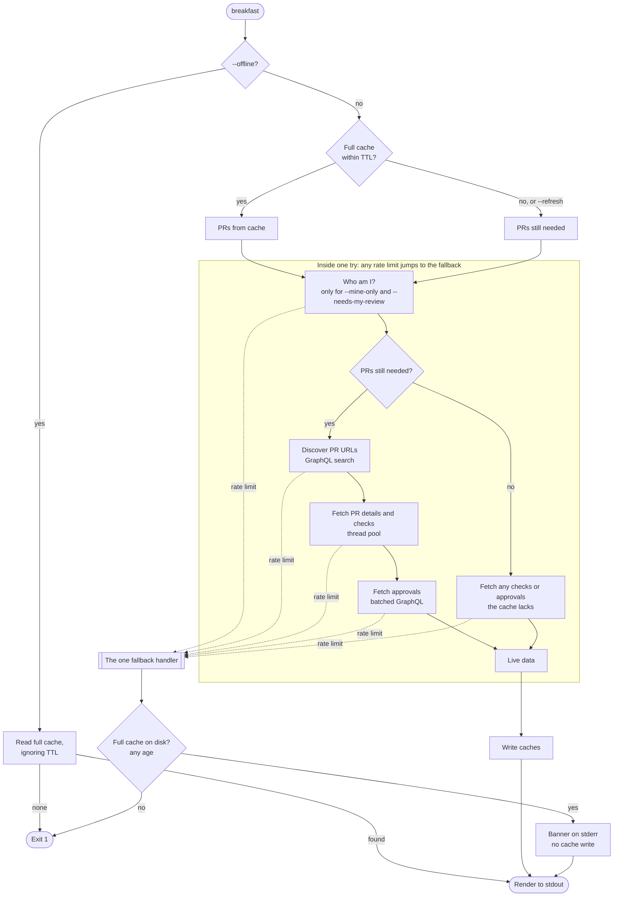
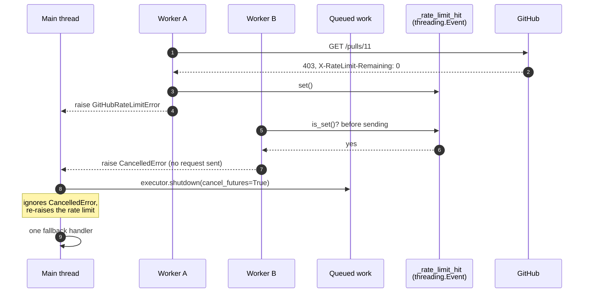
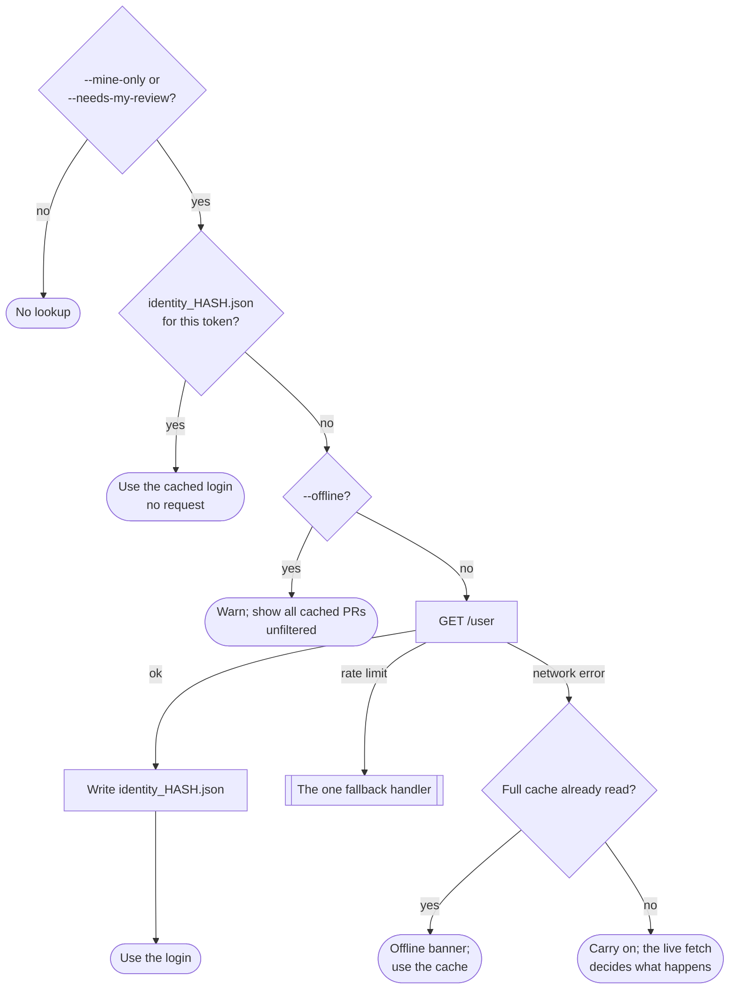

# Rate-Limit Cache Fallback

> **Tracking issue:** [#392 — Fall back to cache when GitHub API limits are exhausted](https://github.com/mrsixw/breakfast/issues/392)
>
> Builds on [PR Caching](pr-caching.md). Read that first for the cache layers.

## Overview

A big organisation can spend a GitHub rate limit before breakfast finishes
reading its pull requests. Before this change the run exited with an error, so
the user saw nothing at all at exactly the moment breakfast had a perfectly
good answer on disk from the last run.

Now a rate limit is treated like a dropped network connection: breakfast stops
asking GitHub, shows the most recent full cache however old it is, and says so.

```text
🥞 GitHub REST API rate limit exceeded; displaying local cached data from
12 minutes ago. Live GitHub data should be available after 2026-07-13 11:19:37 UTC.
```

Three pieces make that work:

1. **One fallback.** Wherever the limit strikes, a single handler serves the
   cache. ([Run flow](#run-flow))
2. **One stop signal.** The first request to hit the limit stops every other
   worker from sending another. ([Stopping the workers](#stopping-the-workers))
3. **A login cache per token.** `--mine-only` and `--needs-my-review` keep
   working without asking GitHub who you are. ([The login cache](#the-login-cache))

## Behaviour

| Situation | Result | Exit |
| --- | --- | --- |
| Rate limited, full cache on disk | Cache shown with the banner above, whatever its age | 0 |
| Rate limited, no full cache, or `--no-cache` | Error naming the API and its reset time; `stdout` empty | 1 |
| Rate limited during `--refresh` or `--refresh-prs` | Cache shown; the banner says the refresh could not be completed | 0 |
| Rate limited part-way through fetching | Partial results discarded; the cache on disk is not touched | 0 |
| A 403 that is not a rate limit (permissions) | Unchanged: an ordinary error | 1 |

Only the **full** cache (Layer 1, `prs_<key>.json`) is used as a fallback. It
is the only layer that holds a complete, consistent answer: PRs, checks and
approvals written together by one run. Mixing a stale full cache with fresh
per-repo entries could show a PR with someone else's check status.

## Run flow

Every request that fetches PR data sits inside one `try` in `cli.breakfast`,
so there is exactly one `except GitHubRateLimitError`. Before this design there was one per
fetch phase, each re-assigning a dozen variables slightly differently.



The fallback handler (`cli.py`, the `except GitHubRateLimitError` after the
fetch):

1. Reads the full cache with the TTL ignored (`_read_degraded_cache`). With
   `--no-cache` it does not look.
2. If there is nothing, prints the error and exits 1 (`_handle_rate_limit`).
3. Otherwise builds complete status maps from the cache (`_cached_status_maps`),
   so a PR the cache has no check status for shows `none`, not a crash.
4. Marks the run offline: no cache write, no update check. Partial live results
   never overwrite the cache.
5. Prints the banner (`_emit_rate_limit_cache_banner`).

Each phase that leaves a progress line open (`Fetching checks...`) ends it
before re-raising, so the banner starts on its own line.

## Stopping the workers

PR details, checks and approvals are fetched by up to `--workers` threads at
once (64 by default). When one of them hits the limit, the rest are no use: the
run is about to fall back to the cache, so anything they fetch is thrown away,
and every request they send makes the limit worse.



`api.py` owns the signal:

- `_rate_limit_hit` is one module-level `threading.Event`.
- `_stop_for_rate_limit()` is the only place a rate limit becomes an exception.
  It records the stats, sets the event, logs, and returns the error to raise.
- `_raise_if_rate_limited()` runs immediately before every HTTP request, REST
  and GraphQL, including retries. Once the event is set, it raises
  `CancelledError` instead of sending.
- `reset_api_stats()`, called at the start of each run, clears it.

A request already on the wire when the limit hits is allowed to finish; Python
cannot cancel it. At most `--workers` requests are wasted that way, and none of
them is followed by another.

### Why an Event, and not more locks

The first version of this change registered a fresh event per thread pool in a
global slot, guarded the slot with its own lock, and checked on removal that it
was not clearing a newer pool's event. None of that was needed:

- **Pools never overlap.** PR details, checks and approvals run one after
  another, so there is never a second event to keep apart from the first.
- **A rate limit ends the run's use of GitHub.** The CLI always either falls
  back or exits, so stopping *every* later request in the process is exactly
  right, not just the ones in the current pool.
- **An Event is already thread-safe.** `set()` and `is_set()` need no lock
  around them.

Two locks remain in `api.py`. Both predate this change, and both protect a
read-modify-write that several threads really do perform:

| Lock | Protects | Why it is needed |
| --- | --- | --- |
| `_api_stats_lock` | the `--api-stats` counters | `stats["rest_calls"] += 1` from 64 threads would lose counts |
| `_throttle_lock` | `_throttle_until`, the shared secondary-limit pause | two workers extending the pause at once must not shorten it |

## Recognising a rate limit

GitHub reports a spent limit in several different ways depending on the API and
on which limit it is. Everything else that looks similar, such as a 403 for a
repository the token cannot see, must stay an ordinary error.

| API | Response | Meaning | breakfast |
| --- | --- | --- | --- |
| REST | `429` | rate limited | stop |
| REST | `403` with `X-RateLimit-Remaining: 0` | primary budget spent | stop |
| REST | `403` with `Retry-After` | secondary limit | stop |
| REST | `403` whose body says "rate limit exceeded" | rate limited | stop |
| REST | any other `403` | permissions | ordinary HTTP error |
| GraphQL | `403`/`429` with `X-RateLimit-Remaining: 0` | primary budget spent | stop |
| GraphQL | other `403`/`429` secondary signal | secondary limit | shared pause and retry; stop after `MAX_RETRIES` |
| GraphQL | any other `403` | permissions | `GitHubForbiddenError`, as before |
| GraphQL | `200` with a `RATE_LIMITED` error | budget spent | stop |
| either | `200` with `X-RateLimit-Remaining: 0` | that was the last allowed request | use the data; mark the limit exhausted |

REST does not retry a secondary limit; GraphQL does, because one GraphQL
request can cover fifty PRs and is worth waiting for. The pause is shared, so
one worker being told to wait holds every worker off
([#473](https://github.com/mrsixw/breakfast/issues/473)).

The reset time in the messages comes from `X-RateLimit-Reset` when GitHub sends
it, otherwise from `Retry-After` seconds from now
(`_rate_limit_reset_time`). `GitHubRateLimitError.resource` says which budget
ran out, `"rest"` or `"graphql"`; they are separate, so the banner names it.

## The login cache

`--mine-only` and `--needs-my-review` compare each PR against your GitHub
login, which comes from `GET /user`. Two problems with how that worked before:

- **It was asked for on every run**, even when every PR came from the cache. A
  run that should make no requests made one, and during a rate limit that one
  request is enough to fail.
- **It was cached in one shared `user.json`.** Switch to a different token, a
  work account say, and an offline run would filter by the *other* account's
  login, silently showing the wrong PRs.

Now the login is cached per token, and read before asking GitHub:



- **The file name is a hash of the token**: the first 16 hex characters of its
  SHA-256 (`cache.identity_cache_path`). The token itself is never written to
  disk, and two tokens can never share a file.
- **It never expires.** A token belongs to one account for its whole life, so
  there is nothing for it to fall out of date with.
- **It is written whether or not `--cache` is on**, because a later `--offline`
  run is the one that needs it
  ([#334](https://github.com/mrsixw/breakfast/issues/334)). It holds one login,
  not your PRs.
- **It is read only when the cache is enabled**, like every other cache file.
  `--offline` turns the cache on.

The old `user.json` is no longer read. A run that needs the login simply looks
it up once more and writes the new file.

## What `--api-stats` reports

The debug summary distinguishes "out of budget" from "not used this run",
which matter differently when diagnosing a slow or failed run:

```text
  API calls:        41 (38 REST + 3 GraphQL)
  REST rate limit:   exhausted (0 requests remaining)
  REST rate resets:  11:19:37 UTC
  GQL rate limit:   not reported this run
  Data source:      local cache (12 minutes ago)
```

- **Calls count attempts**, including retries and the rate-limited response
  itself, because those spend budget too.
- **`exhausted`** is set by any response that leaves the budget at zero, or by
  the stop path.
- **`Data source`** is `local cache (<age>)` whenever any cache was served, and
  `live GitHub API` otherwise. It is derived from the age of the cache that was
  served, so there is no separate flag to keep in step.

## Cache files

All in `$XDG_CACHE_HOME/breakfast/` (default `~/.cache/breakfast/`). The
identity file is the only one this change adds.

| File | Holds | Expires | Used as rate-limit fallback |
| --- | --- | --- | --- |
| `prs_<key>.json` | full answer: PRs, checks, approvals | `--cache-ttl` | **yes**, at any age |
| `graphql_<key>.json` | discovered PR URLs | `--cache-ttl` | no |
| `pr_repo_<key>.json` | PRs, checks, approvals for one repo | `--cache-ttl` | no |
| `repos_<key>.json` | the owner's repository names | 24 hours | no |
| `identity_<hash>.json` | the login for one token | never | supplies the login |

## Testing

All of this is tested offline with `requests-mock`; nothing here needs a real
rate limit.

- **`tests/test_api.py`**:
  - each row of the recognition table;
  - a plain 403 staying an ordinary error;
  - the last allowed request still being used;
  - a rate limit stopping every later request, REST and GraphQL, until
    `reset_api_stats()`;
  - a terminal secondary limit stopping the next request;
  - the shared pause.
- **`tests/test_cli.py`**:
  - falling back from each phase: login lookup, PR details, checks and
    approvals;
  - no cache, `--no-cache`, and `--refresh` banners;
  - the cache file not being overwritten by partial results;
  - `stdout` staying empty on failure;
  - a complete cache hit with a cached login making zero requests.
- **`tests/test_cache.py`**: the identity file, including that the token does
  not appear in its name or contents, and that two tokens get two files.
